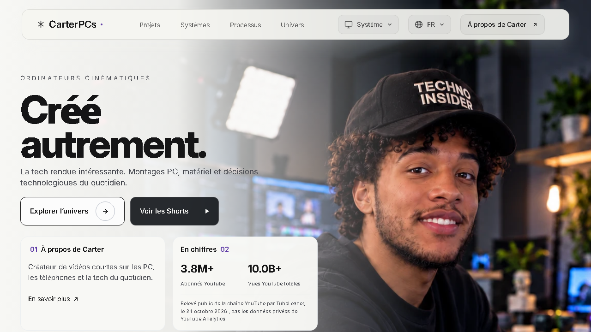
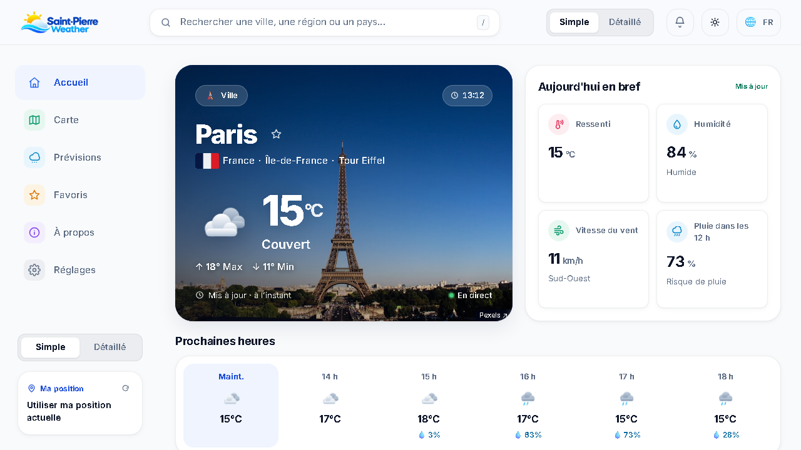

  <h1>Hi, I'm Walker 👋</h1>
  
  
IT student in France interested in IT support, cybersecurity, and web development.

<h2>🌟 Featured projects</h2>

<table>
  <tr>
    <td width="50%" valign="top">
      
      <h3>CarterPCs — Interactive Portfolio Concept</h3>
      
An independent fan-made portfolio inspired by CarterPCs' technology content. Not client work and not affiliated with CarterPCs.

      
<strong>React · TypeScript · Responsive design</strong>

      
<a href="https://carterpcs-portfolio.vercel.app/">Live demo ↗</a> · <a href="https://github.com/WalkerTech15/CarterPCs-Creative-Concept">Source code ↗</a>

    </td>
    <td width="50%" valign="top">
      
      <h3>SaintPierre Weather</h3>
      
A school weather project with forecasts, an interactive map, saved places, and offline support.

      
<strong>HTML · CSS · JavaScript</strong>

      
<a href="https://saintpierre-weather-com.vercel.app/">Live demo ↗</a> · <a href="https://github.com/WalkerTech15/SaintPierre-Weather">Source code ↗</a>

    </td>
  </tr>
</table>

<table>
  <tr>
    <td width="38%" valign="top">
      <h2>✨ Other projects</h2>
      
<strong><a href="https://github.com/WalkerTech15/Open-Browser">🌐 Open Browser</a></strong> An open-source browser project focused on privacy, performance, and user control.

      

      
<strong><a href="https://github.com/WalkerTech15/Local-Agent">🤖 Local Agent</a></strong> A personal project exploring a local AI assistant and privacy-aware workflows.

    </td>
    <td width="31%" valign="top">
      <h2>💻 Programming languages</h2>
      

        
        
        
      

      

      <h2>🗣️ Spoken languages</h2>
      
Vietnamese · French · English

    </td>
    <td width="31%" valign="top">
      <h2>📚 Currently learning</h2>
      
Cybersecurity, Linux, networking, and deeper Python skills.

    </td>
  </tr>
</table>

<a href="https://github.com/WalkerTech15">GitHub</a> · <a href="https://www.youtube.com/@WalkerTech15">YouTube</a>

